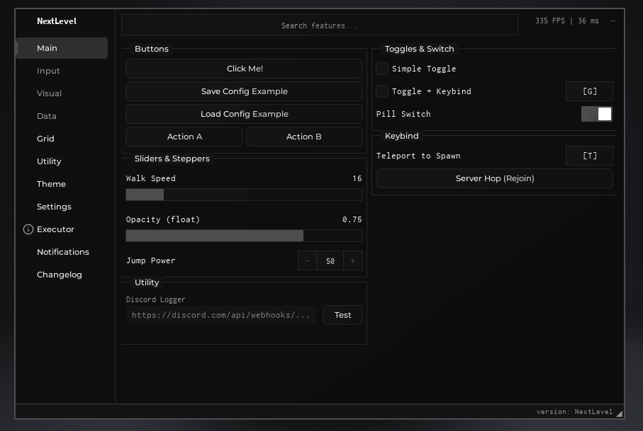
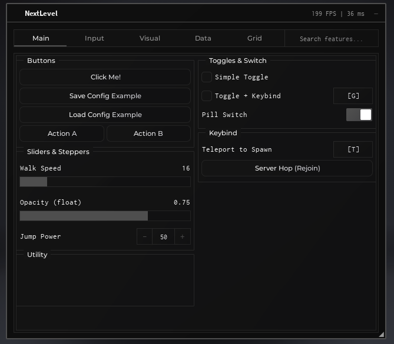
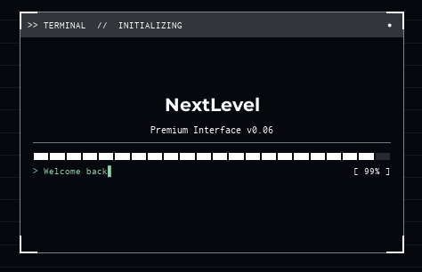

# NextLevel UI `v0.07`

A modern, self-contained Roblox Luau UI library designed for clean ergonomics, reactive theming, config persistence, and both **Sidebar** and **Classic** layouts.

**Live Documentation & API Reference:** https://acidgorgon.github.io/NewLibrary/

---

## Previews

| Sidebar Mode | Classic Mode | Boot Loader |
| :---: | :---: | :---: |
|  |  |  |

---

## Quick Start

```lua
local Library = loadstring(game:HttpGet(
    "https://raw.githubusercontent.com/Acidgorgon/NewLibrary/main/versions/0.07/Lib.lua"
))()

-- Optional animated boot splash (auto-skips if SilentExecution is saved)
Library:InitLoad({
    Title       = "NextLevel",
    SubTitle    = "Premium Interface v0.07",
    Icon        = 10734914443,
    Duration    = 2.5,
    AccentColor = Color3.fromRGB(255, 255, 255),
})

local Window = Library.new({
    Title = "NextLevel",
    Size  = UDim2.fromOffset(740, 520),
    Key   = Enum.KeyCode.RightControl,
    Mode  = "Sidebar", -- "Sidebar" or "Classic"
    Icon  = 10734914443,
})

local MainTab = Window:Tab("Combat", 10723374643)
local CoreSec = MainTab:Section("Features")

CoreSec:Toggle("Enable Aimbot", false, "AimbotToggle", function(state)
    print("Aimbot:", state)
end)

CoreSec:Slider("FOV Radius", 20, 300, 90, 0, "FovSlider", function(val)
    print("FOV:", val)
end)

-- Pre-built management tabs
Window:BuildUtilityTab(10723374643)
Window:BuildThemeTab(10734947300)
Window:BuildSettingsTab(10734944524)
Window:BuildNotificationLogTab(10734950056)
Window:BuildExecutorTab(10723415903)
Window:BuildUpdateTab({
    VersionUrl = "",
    SourceUrl  = "https://raw.githubusercontent.com/Acidgorgon/NewLibrary/main/versions/0.07/Lib.lua",
    Version    = "0.07",
})
Window:BuildChangelogTab({
    ["0.07"] = "Dropdown cleanup, ColorPicker fixes, Classic z-index fixes, Section:Clear(), and Auto-Update improvements.",
})

Window:SetPanicKey(Enum.KeyCode.End)
```

---

## Highlights

- **Dual Layouts:** Choose between `Sidebar` (vertical icon/tab rail + header search) and `Classic` (horizontal tab strip + compact header), each rendering balanced two-column sections with dynamic sizing, global search filtering, and a bottom-right resize grip (`400x300` min).
- **Rich Widget Suite:** Buttons, dual Button Rows, Toggles, ToggleBinds, Switches, Sliders, Steppers, Keybinds, Single & Multiline Inputs, TagInputs (chip collections), Single/Multi Dropdowns, SearchableDropdowns, PlayerDropdowns, RadioGroups, HSV+Alpha ColorPickers, dynamic Labels/Paragraphs (`:SetText`), ProgressBars, StatusIndicators, Alerts, Images, KeyValueTables, Auto-scrolling Consoles, Timers, Bar Charts, Discord Webhooks, responsive Grids (with legacy arg support), Tooltips, and Modal Dialogs.
- **Reactive Theme Engine:** 15 `Color3` keys (including `SelectedTab`) + `TextSize` and `BaseHeight`, `6` built-in presets (`Cyberpunk`, `Midnight`, `Toxic`, `Ocean`, `Classic`, `Ghost`), optional RGB Chroma line cycling, and click-to-update live tweening via `ThemeEvent`.
- **Config & Autoload System:** Per-place JSON profiles (`{WindowName}_Configs/{PlaceId}/`) saving all flags, keybinds, color pickers, webhook URLs, active theme overrides, and silent execution state.
- **Built-in System Tabs (7):** Utility (Auto Clicker, Rejoin, Server Hop, Job ID), Theme Manager, Settings & Configs, Notification History Log, Internal Luau Executor, Changelog (`ParseVersion` sorted), and Auto-Updater (`CheckForUpdate` / `AutoUpdate`).
- **HUD & Utilities:** Draggable Watermark (FPS & ping), floating Active Keybinds HUD, slide-in Notifications (with standalone post-unload fallback), `Section:Clear()`, and clean full teardown via `Window:Unload()` / Panic Key.

---

## Repository Layout

| Path | Description |
| :--- | :--- |
| [`versions/0.07/Lib.lua`](versions/0.07/Lib.lua) | **Current** v0.07 library source (load this in production scripts). |
| [`versions/0.07/Test.lua`](versions/0.07/Test.lua) | Complete feature showcase and test script for v0.07. |
| `versions/0.01/` – `versions/0.06/` | Archived historical releases (kept untouched for reference). |
| [`docs/index.html`](docs/index.html) | Full interactive API reference site (GitHub Pages). |
| [`docs/img/`](docs/img/) | UI screenshots for Sidebar, Classic, Settings, and InitLoad. |
